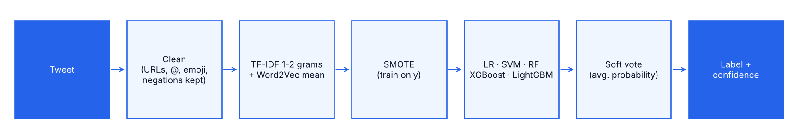
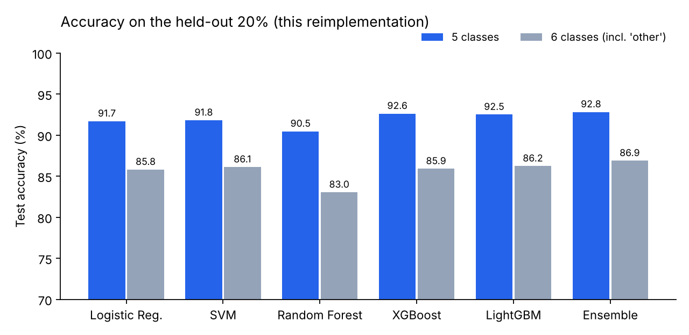
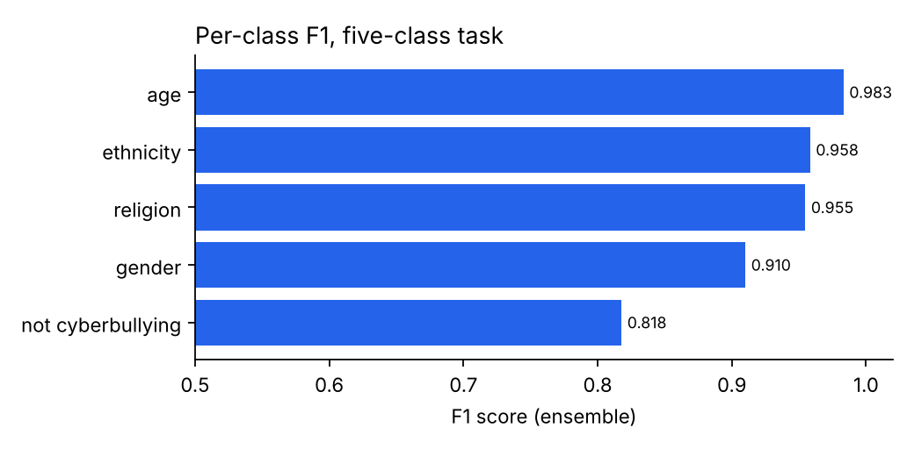
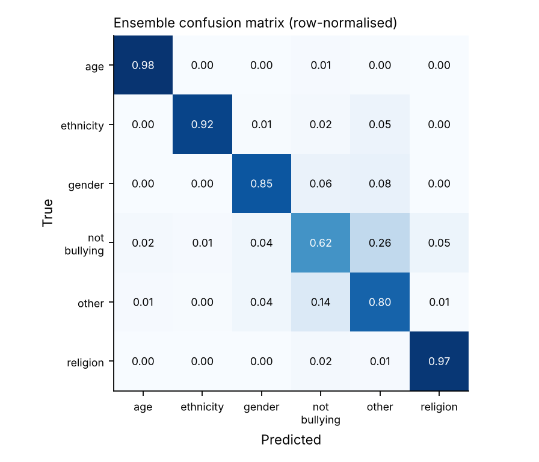

# Cyberbullying Detection: a Multi-Model Ensemble

[](https://github.com/Drakeion2532/cyberbullying-detection/actions/workflows/tests.yml)

This repository is a reference implementation of the paper

**["Multi-Model Ensemble Approach for Enhanced Cyberbullying Detection Across Diverse Categories"](https://ieeexplore.ieee.org/document/10823191)**
S. Patil, **S. Punde**, P. Sahani, A. Salve. *2024 International Conference on IoT Based Control Networks and Intelligent Systems (ICICNIS)*, IEEE, pp. 195–202, 2024. DOI [10.1109/ICICNIS64247.2024.10823191](https://doi.org/10.1109/ICICNIS64247.2024.10823191)

It takes a tweet or comment and says whether it is bullying and, if so, what the bullying targets: **age, ethnicity, gender/sexuality or religion**. Five classifiers (LightGBM, XGBoost, SVM, Random Forest and Logistic Regression) each read the same TF-IDF + Word2Vec features. A soft-voting ensemble then averages their probabilities. SMOTE balances the training data.



> **About the numbers.** I rebuilt the code for this repository from the method in the paper. Results in the "This reimplementation" columns come from running this code. Results in the "Paper" column are quoted from the publication. The two differ because the test set here is stricter (see [Why the scores differ](#why-the-scores-differ-from-the-paper)).

## Results

The test set is a held-out, stratified 20% (seed 42). Duplicate tweets and tweets that carry conflicting labels were removed *before* the split.

| Model | Paper | This reimplementation: 5 classes | This reimplementation: 6 classes |
|---|---|---|---|
| Logistic Regression | 92–93% (range for single models) | 91.7% | 85.8% |
| SVM (calibrated LinearSVC) | 92–93% | 91.8% | 86.1% |
| Random Forest | 92–93% | 90.5% | 83.0% |
| XGBoost | 92–93% | 92.6% | 85.9% |
| LightGBM | 92–93% | 92.5% | 86.2% |
| **Soft-voting ensemble** | **≈ 94%** | **92.8%** (macro-F1 0.925) | **86.9%** (macro-F1 0.858) |



As in the paper, the ensemble beats every single model, and the four targeted categories are the easiest to detect. The paper reports F1 between 0.84 and 0.99 for gender, religion, age and ethnicity. Here, on the 5-class task, the ensemble gets **age 0.983 · ethnicity 0.958 · religion 0.955 · gender 0.910**, with not_cyberbullying at 0.818.

<p>


</p>

**What the confusion matrix shows.** Most mistakes happen between *not_cyberbullying* and *other_cyberbullying*. "Other" is a vague catch-all in the dataset, and many of its tweets read like ordinary banter. That is why the 6-class task scores about 6 points lower. In practice, a moderation tool should send these borderline cases to a human reviewer and not act on them automatically.

### Why the scores differ from the paper

* **Deduplication before splitting.** The public dataset has 1,675 duplicate rows, and some duplicates carry different labels. If they aren't removed, the same text can land in both train and test, which inflates accuracy. This code removes them first.
* **Two task set-ups.** The paper's per-category results focus on the four targeted types. `five_class` (the default) keeps those four plus *not_cyberbullying*. `six_class` also keeps the noisy *other_cyberbullying* class.
* **Hyper-parameters.** The paper doesn't publish its exact settings, so the values in `cbd/models.py` are sensible defaults and haven't been tuned on the test set.

## Dataset

**Cyberbullying Classification** (47,692 tweets, six balanced classes), from J. Wang, K. Fu, C.-T. Lu, ["SOSNet: A Graph Convolutional Network Approach to Fine-Grained Cyberbullying Detection"](https://doi.org/10.1109/BigData50022.2020.9378065), IEEE BigData 2020, as published on Kaggle ([andrewmvd/cyberbullying-classification](https://www.kaggle.com/datasets/andrewmvd/cyberbullying-classification)). A copy is in `data/cyberbullying_tweets.csv` for reproducibility, under the dataset's original terms (CC BY 4.0). Please cite the SOSNet paper if you use it.

The data contains real abusive language, including slurs. It is here only to train and test a detector.

| After cleaning | 5-class | 6-class |
|---|---|---|
| Tweets | 38,135 | 44,378 |
| Train / test | 30,508 / 7,627 | 35,502 / 8,876 |

## How it works

| Step | File | What it does |
|---|---|---|
| Load + clean labels | `cbd/data.py` | Drops tweets with conflicting labels, deduplicates, makes a stratified 80/20 split |
| Text cleaning | `cbd/preprocess.py` | Lower-cases; removes URLs, @mentions, HTML entities, emoji and digits; keeps hashtag words; expands "n't" to "not" so negations survive; Porter stemming |
| Features | `cbd/features.py` | TF-IDF on word 1–2 grams (20k features) stacked with the mean Word2Vec vector (100-d, trained on the training tweets only) |
| Balancing | `cbd/train.py` | SMOTE on the training features only; test data is never resampled |
| Models + voting | `cbd/models.py` | The five classifiers. `SoftVote` averages their class probabilities (the same as scikit-learn's `VotingClassifier(voting="soft")`) |
| Use it | `cbd/predict.py`, `app.py` | Command line and Streamlit app, with each model's vote shown |

## Run it

```bash
python -m venv .venv && source .venv/bin/activate      # Windows: .venv\Scripts\activate
pip install -r requirements.txt

python -m cbd.train                      # 5-class task, about 5–10 minutes on a laptop CPU
python -m cbd.train --task six_class     # optional
python -m cbd.predict "girls can't code lol" "had a lovely lunch with friends"
streamlit run app.py                     # web app at http://localhost:8501

pytest -q                                # tests
python scripts/make_figures.py           # redraw the charts from results/*.json
```

Trained models are written to `models/`. They are not committed because they are regenerated by `cbd.train`. Metrics go to `results/metrics_<task>.json`.

## Limits

* The model learns from 2020-era English tweets. Slang changes, and so do other platforms and languages.
* It can't recognise sarcasm, quoting and reclaimed words reliably. Treat its output as a flag for human review, never as an automatic penalty.
* Keyword-heavy categories (age, religion) score highest partly because the dataset was collected with keyword searches. Accuracy on messages in the wild will be lower.

## Project structure

```
cbd/            package: data, preprocess, features, models, train, predict
app.py          Streamlit app
data/           the public tweet dataset (CSV)
results/        metrics JSON for both tasks
docs/figures/   charts used in this README
scripts/        figure generation
tests/          pytest suite (preprocessing, dedup, toy end-to-end run, dataset checks)
```

## Licence and credit

MIT © 2026 [Shubhan Punde](https://github.com/Drakeion2532). You're welcome to learn from and reuse this code; the licence requires keeping the copyright notice, and presenting the project as your own work is not permitted. To cite it, use [CITATION.cff](CITATION.cff).

<sub>Project ID: sp2532-f30cd46f33af</sub>
